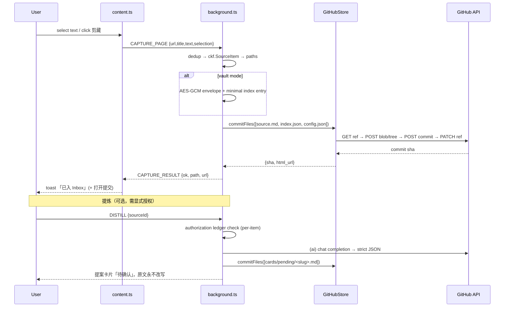
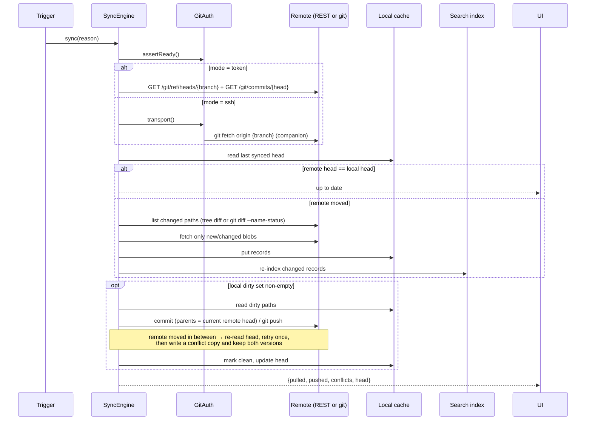

# History: 01-blueprint.md

Append-only archive. Do not edit or delete past snapshots.
Newest entries appended at **bottom**.

| Metric | Value |
|--------|-------|
| snapshots | 2 |
| first_archived | 2026-07-09 00:00 |
| last_archived | 2026-09-29T17:50:00+08:00 |

---

## [ARCHIVE] 01-blueprint.md · v1 · 2026-07-09 00:00

| Field | Value |
|-------|-------|
| version | 1 |
| archived_at | 2026-07-09T00:00:00+08:00 |
| reason | new_requirement — superseded by req-2026-07-09-synapse-git-sync |
| trigger | /od (new requirement on main) |
| requirement_id | req-2026-07-09-synapse-ext-mvp |
| summary | Browser-extension MVP blueprint: capture → inbox → AI distill → GitHub (token-only, write-only, vault default) |

<!-- BEGIN SNAPSHOT -->---
version: 1
artifact: 01-blueprint.md
requirement_id: req-2026-07-09-synapse-ext-mvp
approach: "A — Single WXT package with a pure-core boundary (recommended)"
last_updated: 2026-07-09T00:00:00+08:00
history_ref: 01-blueprint-history.md
---

# Blueprint: OmniPilot Synapse — 浏览器插件 MVP（捕获 → 提炼 → GitHub 落库）

## 1. Requirement Summary

Implement the §5A "浏览器插件 = 捕获先锋" role as working software: one-click web clip
(title / URL / 正文 / 划线摘录) drops into an Inbox, an **opt-in, ledgered** AI distill turns a
SourceItem into a结构化 KnowledgeCard proposal, and everything is persisted to a **GitHub
repository** as the single authoritative store. Scope is extension-only; the model layer must
accept mainstream LLM providers; storage must stay adapter-shaped even though GitHub is the only
implementation.

## 2. Architecture Overview

```mermaid
flowchart LR
  subgraph Page["Web page (untrusted)"]
    CS[content.ts<br/>selection bubble + panel]
  end
  subgraph SW["Background service worker (trusted)"]
    MSG[messages router]
    CAP[capture/extract]
    CORE[lib/core<br/>CKF · paths · frontmatter · dedup]
    DIST[distill + providers + ai-client]
    CODE[content codec<br/>plaintext | AES-GCM]
    GAPI[github-api<br/>Contents + Git Data]
    SEC[security<br/>vault · session · redact · rate-limit]
    SET[settings-store]
  end
  subgraph UI["Extension UI"]
    POP[popup console]
    OPT[options page]
  end
  GH[(GitHub repo<br/>knowledge base)]

  CS -->|CAPTURE_* / public prefs only| MSG
  POP --> MSG
  OPT -->|SET_* secrets stay here| MSG
  MSG --> CAP --> CORE --> CODE --> GAPI --> GH
  MSG --> DIST --> CORE
  DIST -.explicit authorization.-> GH
  SEC --- MSG
  SET --- MSG
```

Plain-text summary: the content script can only *offer* a capture and read non-secret public
preferences; every secret (GitHub PAT, model API keys, vault passphrase) and every network write
lives in the background service worker. A capture is normalized into the Canonical Knowledge
Format, optionally encrypted by the content codec, then committed to GitHub through a single
adapter. AI distillation is a separate, explicitly authorized path that produces *proposals* only.

### 2.1 Repository / package layout

```
omnipilot-synapse/
├─ apps/extension/                 # the only real package in this MVP
│  ├─ entrypoints/
│  │  ├─ background.ts             # SW: router, vault, secrets, GitHub, AI
│  │  ├─ content.ts                # page overlay: selection bubble + capture panel
│  │  ├─ popup/                    # toolbar console (main.ts, index.html, style.css)
│  │  └─ options/                  # settings: provider · GitHub · security · ledger
│  ├─ lib/
│  │  ├─ core/                     # PURE — no browser/network API imports (enforced by test)
│  │  │  ├─ ckf.ts                 # SourceItem · KnowledgeCard · Topic · ReviewState + validators
│  │  │  ├─ paths.ts               # id + slug + date path builders
│  │  │  ├─ markdown.ts            # YAML-frontmatter encode/decode (no deps)
│  │  │  └─ dedup.ts               # url / near-duplicate body keys
│  │  ├─ capture/extract.ts        # DOM → { title, url, byline, text, selection }
│  │  ├─ providers.ts              # provider catalog: base URL, auth style, model list
│  │  ├─ ai-client.ts              # per-provider request/response mapping + scrubbed errors
│  │  ├─ distill.ts                # prompt + parse → KnowledgeCard proposal (never auto-apply)
│  │  ├─ store/
│  │  │  ├─ types.ts               # KnowledgeStore adapter interface
│  │  │  ├─ github-api.ts          # REST primitives (fetch injected)
│  │  │  ├─ github-store.ts        # GitHubStore implements KnowledgeStore
│  │  │  └─ codec.ts               # plaintext codec | encrypted envelope codec
│  │  ├─ security/{crypto-key,key-session,redact,rate-limit}.ts
│  │  ├─ settings-store.ts         # storage.local public/secret split
│  │  ├─ messages.ts               # typed content ⇄ background ⇄ UI protocol
│  │  └─ i18n.ts                   # zh_CN / en
│  ├─ public/                      # icons, _locales
│  ├─ wxt.config.ts · tsconfig.json · vitest.config.ts · playwright.config.ts
│  └─ package.json
├─ package.json                    # root delegating scripts (npm run dev/test/pack)
├─ Makefile · README.md · docs/
```

`lib/core/**` is the future extraction seam: when the WeChat Mini Program arrives it becomes
`packages/core` without rewriting the extension, because it imports nothing browser-specific.

## 3. Module / Service Breakdown

| Module | Responsibility | Key Interfaces | Dependencies |
|--------|---------------|----------------|--------------|
| `entrypoints/background.ts` | Trust boundary. Owns vault, secrets, all network I/O, message routing, context menu + command registration, per-tab rate limits | `messages.ts` handlers; `chrome.runtime.onMessage` | all `lib/*` |
| `entrypoints/content.ts` | Selection bubble, clipboard/keyboard trigger, in-page capture panel, toast feedback. **Never** loads keys or settings | `CAPTURE_SELECTION`, `CAPTURE_PAGE`, `GET_PUBLIC_PREFS`, `CAPTURE_RESULT` | `messages.ts`, `i18n.ts` |
| `entrypoints/popup/*` | Console: master switch, current-tab clip button, live status (store, mode, key present, pending AI auth), quick links to options | `GET_STATUS`, `CLIP_ACTIVE_TAB`, `SET_PUBLIC_PREF` | `messages.ts` |
| `entrypoints/options/*` | Provider config (key + base URL + model), GitHub config (PAT + repo/branch/path + visibility check), security (vault setup/unlock/mode), AI authorization ledger, export/reset | `SET_PROVIDER`, `SET_GITHUB`, `VAULT_*`, `GET_LEDGER` | `messages.ts` |
| `lib/core/ckf.ts` | Canonical Knowledge Format types + runtime validators for SourceItem / KnowledgeCard / Topic / ReviewState | `parseSourceItem`, `parseKnowledgeCard`, `newSourceItem` | none (pure) |
| `lib/core/paths.ts` | Deterministic repo paths: `inbox/YYYY/MM/<slug>-<id8>.md`, `cards/pending/…`, ids (ULID-like) | `sourceItemPath`, `cardPath`, `newId` | none |
| `lib/core/markdown.ts` | Frontmatter + body encode/decode, quote-safe YAML subset | `encodeDoc`, `decodeDoc` | none |
| `lib/core/dedup.ts` | Dedup keys: normalized URL, canonical text hash, near-duplicate shingle simhash | `urlKey`, `contentKey`, `isNearDuplicate` | none |
| `lib/capture/extract.ts` | Readability-style正文抽取, `og:`/meta fallbacks, selection capture, optional snapshot | `extractPage(doc, loc)`, `extractSelection(sel)` | DOM |
| `lib/providers.ts` | Provider catalog (id, label, baseURL, auth header style, default model, capability flags), HTTPS-only + trust rules | `PROVIDERS`, `resolveProvider`, `assertTrustedEndpoint` | none |
| `lib/ai-client.ts` | Provider-specific request/response mapping, timeouts, retry, error scrubbing | `chat({provider, key, baseUrl, model, messages})` | `providers.ts`, `security/redact.ts` |
| `lib/distill.ts` | Structured distill prompt → strict JSON card proposal + validation, evidence links back to source | `distillSourceItem(item, cfg)` | `ai-client.ts`, `core/ckf.ts` |
| `lib/store/types.ts` | Adapter contract so GitLab/Gitee/self-hosted-DB/local-FS can be added later | `KnowledgeStore` | none |
| `lib/store/github-api.ts` | GitHub REST v3 primitives: token check, repo meta, contents read, blob/tree/commit/ref-write, error mapping | `createGithubApi({fetch, token, owner, repo, branch})` | injected `fetch` |
| `lib/store/github-store.ts` | Implements `KnowledgeStore`: atomic multi-file commit, dir listing, visibility probe, public-repo guard | `commitFiles`, `readFile`, `listDir`, `probe` | `github-api.ts`, `codec.ts` |
| `lib/store/codec.ts` | Content tier: `transparent` (Markdown + frontmatter) vs `vault` (AES-GCM envelope + cleartext minimal index) | `encodeDoc`, `decodeDoc`, `indexEntry` | `security/crypto-key.ts` |
| `lib/security/crypto-key.ts` | PBKDF2-SHA256 + AES-GCM, envelope format, key material never persisted plain | `deriveKey`, `encryptText`, `decryptText` | WebCrypto |
| `lib/security/key-session.ts` | Session unlock (TTL), in-memory + `chrome.storage.session`, auto-lock | `unlock`, `lock`, `isUnlocked`, `withKey` | `crypto-key.ts` |
| `lib/security/redact.ts` | Strip token/key substrings from errors, logs and AI echoes | `scrub(text, secrets)` | none |
| `lib/security/rate-limit.ts` | Per-tab sliding-window limits for `ai.*` and `gh.*` | `allow(bucket, tabId)` | none |
| `lib/settings-store.ts` | `storage.local` split: public prefs vs secret blob; vault-encrypted secrets; migration | `getPublicPrefs`, `getSecrets`, `setSecrets` | `key-session.ts` |
| `lib/messages.ts` | Typed protocol + runtime narrowing; content-script allowlist (no secret-bearing types) | `sendToBackground`, `onMessage` | none |
| `lib/i18n.ts` | zh_CN / en dictionaries, browser locale detect | `t(key, vars)` | none |

## 4. Data Flow



Plain-text summary: a capture is normalized, deduplicated and (in vault mode) encrypted *before*
it leaves the device, then committed to GitHub as one atomic multi-file commit that also updates
the minimal index. Distillation is a separate user-initiated action guarded by a per-item
authorization ledger; its output is written as a *pending proposal* file, so the original text is
never silently rewritten.

### 4.1 GitHub knowledge-base layout

```
.omnipilot/config.json          # {schema_version, security_mode, created_at}   (cleartext, no secrets)
index.json                      # id → {kind, path, created_at, updated_at, hash}  (no body in vault mode)
inbox/YYYY/MM/<slug>-<id8>.md   # SourceItem: frontmatter + 原文/摘录
cards/pending/<slug>-<id8>.md   # AI proposal, 待确认
cards/<slug>-<id8>.md           # confirmed KnowledgeCard (用户采纳后)
topics/<slug>.md                # Topic node
review/state.json               # stability/retrievability/next_review_at (no body)
```
In `vault` mode every content-bearing file is written as `<name>.md.enc`; only
`.omnipilot/config.json`, `index.json` and `review/state.json` stay readable, and they carry
identifiers and timestamps only.

## 5. Integration Points

- **Existing modules affected**: none — greenfield. `docs/requirements/00-requirements.md` §5A/§5B(A)/§6
  is the binding spec; this blueprint narrows it to the extension + GitHub slice.
- **External dependencies**:
  - GitHub REST v3 — `GET /repos/{o}/{r}` (visibility probe), `GET /repos/{o}/{r}/contents/*` (read + sha),
    Git Data API `POST /git/blobs` → `POST /git/trees` → `POST /git/commits` → `PATCH /git/refs/heads/{branch}`
    (atomic multi-file commit). Auth: `Bearer <PAT>`, fine-grained token with **Contents: Read and write**
    on the single target repo only.
  - LLM providers (HTTPS only), two auth styles only:

    | id | Endpoint | Auth style | Default model |
    |----|----------|-----------|---------------|
    | `openai` | `https://api.openai.com/v1` | `Authorization: Bearer` | `gpt-4o-mini` |
    | `deepseek` | `https://api.deepseek.com/v1` | `Authorization: Bearer` | `deepseek-chat` |
    | `anthropic` | `https://api.anthropic.com/v1` | `x-api-key` + `anthropic-version: 2023-06-01` | `claude-3-5-haiku-latest` |
    | `openrouter` | `https://openrouter.ai/api/v1` | `Authorization: Bearer` | `openai/gpt-4o-mini` |
    | `iflytek` | `https://spark-api-open.xf-yun.com/v1` | `Authorization: Bearer <APIPassword>` | `generalv3.5` |
    | `custom` | user-supplied | `Authorization: Bearer` | user-supplied |

    `custom` is HTTPS-only and requires an explicit trust acknowledgement (mirrors
    `requiresBaseUrlTrustAck` in the reference). Anthropic uses the native Messages API rather than
    being proxied through OpenRouter, and iFlytek uses the Spark **OpenAI-compatible HTTP** endpoint
    instead of the reference's HMAC/signed native protocol — this removes the whole signing stack
    and keeps every provider on the same transport.
  - No project backend, no telemetry.

- **Extension permissions (least privilege, stricter than the reference repo)**:
  `permissions: ["storage","activeTab","scripting","contextMenus"]`;
  `host_permissions`: `https://api.github.com/*` + the five known provider hosts above;
  `optional_host_permissions: ["https://*/*"]` requested at runtime **only** when the user configures
  a custom base URL; `content_scripts.matches: ["<all_urls>"]` (the selection bubble must work on any
  page). No `_locales`/`__MSG_*` manifest localization in MVP — a plain `lib/i18n.ts` dictionary keeps
  the manifest simple while still shipping zh_CN + en UI strings.
- **Frontend impact**: yes — new popup console, options page, and an in-page selection bubble/panel,
  following the reference repo's vanilla-TS + CSS approach (no UI framework).

## 6. Design Assumptions

| # | Assumption | Risk Level | Validation |
|---|-----------|------------|------------|
| A1 | MV3 service worker can call `api.github.com` directly using `host_permissions` without a proxy | 🔴 blocking | Phase 3 first task: live `GET /repos/...` from the SW; fallback = `optional_host_permissions` prompt |
| A2 | Git Data API multi-file commit is atomic and sufficient for one capture (source + index + config) | 🟡 acceptable | Unit test against mocked fetch; manual live commit in Phase 4 smoke |
| A3 | GitHub Contents API returns `sha` on read so updates can be chained without a separate tree walk | 🟢 low | Documented API behaviour; covered by adapter test |
| A4 | A user-provided fine-grained PAT with Contents R/W on one repo is enough (no `repo` classic scope) | 🟡 acceptable | Options page validates by probe and reports required scope on 403 |
| A5 | WebCrypto PBKDF2 (250 000 iters) + AES-GCM in the SW unlocks in well under a second, and per-file encryption is sub-millisecond once the key is cached | 🟢 low | Benchmark test in Phase 4; derived key cached for the unlocked session; envelope stores `kdf.iterations` so the cost is upgradable without breaking old files |
| A6 | Readability-lite extraction without a heavy dependency yields usable正文 for most articles | 🟡 acceptable | Golden-sample tests over saved HTML fixtures; user can edit before commit |
| A7 | Content scripts can be kept secret-free (only public prefs + capture payloads cross the boundary) | 🔴 blocking | Build-time assertion script + unit test over the message allowlist |
| A8 | Public-repo misuse is prevented by a hard block that requires explicit typed confirmation | 🔴 blocking | Adapter returns `visibility`, UI blocks commit until user unchecks/confirms |
| A9 | Distill prompt can be constrained to strict JSON that validates against `KnowledgeCard` | 🟡 acceptable | Parser + validator tests with malformed/partial model outputs |
| A10 | Single-package layout with a pure `lib/core` boundary does not need a workspace manager for MVP velocity | 🟡 acceptable | Enforced by a test that asserts `lib/core/**` has no browser/network imports |

## 7. Open Questions

| # | Question | Impact | Default (accepted) |
|---|----------|--------|--------------------|
| Q1 | Monorepo packages vs single package now? | Refactor cost later | **Single package at `apps/extension` with pure `lib/core` boundary**; extract `packages/core` when the mini program starts |
| Q2 | One commit per capture (Git Data API) or one file per Contents PUT? | Atomicity, API calls, conflict handling | **Git Data API atomic commit**, Contents API used for reads |
| Q3 | Distill synchronous at capture or a separate explicit action? | UX friction, privacy exposure | **Separate explicit action**, default OFF, per-item authorization ledger |
| Q4 | Default content tier? | Security vs diff readability | **Vault (encrypted) by default**; transparent-repo mode is an opt-in per-repo setting with a risk acknowledgement |
| Q5 | Snapshot (html/mhtml) capture in MVP? | Repo size, API payload limits | **Off by default, opt-in flag**; text + selection only in MVP |
| Q6 | Inbox layout: flat vs date-partitioned? | Listing cost at scale | **`inbox/YYYY/MM/`** date partition |
| Q7 | iFlytek Spark (HMAC/WebSocket native protocol) in MVP? | Extra auth complexity | **Use the Spark OpenAI-compatible HTTPS endpoint** (`spark-api-open.xf-yun.com/v1`, bearer APIPassword) — same transport as every other provider, no signing stack; never blocks the capture path |
| Q8 | Review scheduling in the extension? | Scope creep vs §5A "插件不承载复习" | **Only write `review/state.json` metadata fields**; no review UI in the extension |

## 8. Risk Log

| Risk | Likelihood | Impact | Mitigation |
|------|-----------|--------|------------|
| PAT leaked from extension storage / logs | Medium | Critical | Vault encryption + session unlock; secrets only in SW; `redact.ts` on all errors; content-bundle assertion in CI |
| User points the extension at a **public** GitHub repo | Medium | Critical (irreversible leak) | Visibility probe + hard block + explicit typed confirmation + README warning; vault mode default |
| MV3 SW terminated mid-commit | Medium | Medium | Keep commits short and idempotent; re-read ref before PATCH; retry once; surface failure in popup |
| GitHub API rate limit / 409 ref conflict | Low | Medium | Backoff on 429/403; on ref conflict re-read head and retry once, then report |
| Model output is not valid JSON / hallucinated fields | High | Medium | Strict schema validation, drop-to-`pending` on failure, never mutate user text automatically |
| Provider sprawl (6 providers × auth styles) | Medium | Medium | Single catalog + one adapter function each; provider contract tests with recorded responses |
| Large page body > API payload comfort | Medium | Low | Cap stored body (default 512 KB) with `truncated: true` + original URL; note in frontmatter |
| Duplicate captures bloat the repo | High | Low | `dedup.ts` url/content keys + index lookup before commit; report "already in Inbox" instead of writing |
| Architecture conflict with `00-project-context.md` | Low | Low | Layout matches the declared "monorepo (planned)"; `lib/core` is the reserved extraction seam — no stack contradiction |
| Custom base URL needs a runtime optional-permission prompt | Medium | Low | Options page requests `https://*/*` on save, explains why, and blocks saving if denied; known providers never need it |

## 9. Approach Comparison (Step 2 record)

| Dimension | **A — Single WXT package + pure `lib/core` seam** ✅ recommended | B — pnpm workspace `packages/core` + `apps/extension` | C — monorepo + self-hosted API stub now |
|-----------|------------------------------------------------------------|---------------------------------------------------|------------------------------------------|
| Core idea | One WXT package at `apps/extension`; canonical model & adapters live in `lib/core/**` which imports no browser/network API | Real workspace packages from day one; extension consumes `@synapse/core` | Add a minimal self-hosted REST service alongside the extension |
| Compatibility | ✅ mirrors the reference repo's proven layout | ⚠️ WXT + workspace resolution + build wiring are new risk | ❌ contradicts the locked scope (extension-only, GitHub-only) |
| Complexity | ✅ lowest — no workspace manager, no cross-package build | ⚠️ moderate — workspace config, build order, dual tsconfig | ❌ high — out of scope by user decision |
| Extensibility | ⚠️→✅ mini program later imports `lib/core` by extraction (mechanical move, no rewrite) | ✅ best-in-class reuse | ✅ but premature |
| Main risk | Boundary erosion — someone imports `chrome.*` into `core` | Toolchain friction delays the MVP | Scope inflation, no user value now |
| Key assumption | A lint-style test can enforce core purity (A10) | Workspace pays for itself before the mini program exists | Users want to self-host before the client works |

**Decision (autopilot default): Approach A.** It preserves the reference repo's proven structure and
delivers the MVP fastest, while the enforced pure-core boundary keeps Approach B available as a
mechanical refactor when the WeChat Mini Program starts. ✅ chosen · rejected: B (premature toolchain
cost), C (out of locked scope).

## 10. Reference-Derived Conventions (from `omnipilot-lingua-bridge` scout)

Adopted deliberately:
- `lib/<name>.ts` + colocated `lib/<name>.test.ts`; **entrypoints stay logic-thin and untested**, all
  validation/crypto/parse logic lives in testable pure modules.
- Vitest: explicit `import { describe, expect, it, vi } from 'vitest'`; default env `node`;
  `environmentMatchGlobs` upgrades only DOM-dependent specs (extract, content UI) to `happy-dom`;
  browser APIs faked with manual `vi.stubGlobal` + `afterEach(vi.unstubAllGlobals)`; clocks injected
  as a `now: () => number` constructor parameter (needed for `rate-limit` and review scheduling).
- Message protocol: typed `is*Request` predicates + a `validateRequest` with hard caps
  (body chars, file count, passphrase length); async listeners `return true`; **secret-bearing
  (`security.*`, `gh.*`, `ai.*`) messages additionally require an extension-page sender** — the
  reference's `isExtensionPageSender` rule.
- Vault: PBKDF2-SHA256 → AES-GCM-256, 16-byte random salt, 12-byte random IV, base64 envelope
  `{ saltB64, ivB64, cipherB64 }` — extended here with `{ v, kdf: { name, iterations } }` so the
  work factor can be raised later without orphaning existing ciphertext. No remembered passphrase,
  no auto-unlock; lock state fails closed with no fallback path.
- Errors are scrubbed (`sanitizeErrorMessage(raw, ...secrets)` replaces exact secret substrings with
  `[REDACTED]`, plus an `sk-…`-style regex) and mapped to fixed user-facing strings.
- Build-time assertion script (`scripts/assert-content-no-secrets.mjs`) fails the build if the
  content bundle contains a secret marker; it asserts the presence of `publicPrefs`.

Explicitly **not** copied (out of scope): the speech/STT/TTS stack, iFlytek HMAC signing, ZH↔EN
language-direction logic, page-translation DOM observers, the LibreTranslate free fallback, the
in-page injected console, and Firefox `browser_specific_settings` (Chrome/Edge MV3 first; the WXT
Firefox target stays available but is not a release gate for this MVP).

<!-- END SNAPSHOT -->

---

## [ARCHIVE] 01-blueprint.md · v2 · 2026-09-29T17:50:00+08:00

---
version: 2
previous_version: 1
artifact: 01-blueprint.md
requirement_id: req-2026-07-09-synapse-git-sync
approach: "A — Native-messaging companion (`apps/git-bridge`) driving system git/ssh (recommended)"
last_updated: 2026-07-09T00:00:00+08:00
history_ref: 01-blueprint-history.md
complexity_effective: XL
---

# Blueprint: GitHub 双授权 + 双向自动同步 + 仓库内可读检索

## 1. Requirement Summary

Extend the shipped 0.1.0 extension so GitHub storage supports **two authorization modes — access token
and SSH**, keeps **`main` as the default branch with a user-overridable branch**, turns note generation
and reading into **automatic push *and* pull**, and stores notes in a **human-readable layout inside
the repository** whenever performance allows — while still meeting the retrieval requirement.

## 2. Architecture Overview

```mermaid
flowchart LR
  subgraph UI["Extension UI"]
    POP[popup: status · sync · search]
    OPT[options: auth mode · branch · sync policy]
  end
  subgraph SW["Background worker (trusted)"]
    RT[messages router]
    AUTH[GitAuth<br/>token | ssh]
    SYNC[SyncEngine<br/>pull → reconcile → push]
    CACHE[(local cache<br/>IndexedDB)]
    IDX[SearchIndex<br/>postings shards]
    VAULT[vault: token · passphrase · ssh key ref]
    REST[github-api<br/>REST v3]
  end
  subgraph HOST["Companion process (new, optional)"]
    BRIDGE[git-bridge<br/>native messaging]
    GIT[system git + ssh<br/>agent · ~/.ssh/config]
  end
  GH[(GitHub repository)]

  POP --> RT
  OPT --> RT
  RT --> AUTH
  AUTH --> SYNC
  SYNC --> REST -->|HTTPS + PAT| GH
  AUTH -->|mode = ssh| BRIDGE --> GIT -->|git@github.com| GH
  SYNC <--> CACHE
  SYNC --> IDX
  AUTH -. credentials .- VAULT
  SYNC -->|pull| CACHE
  CACHE --> POP
```

Plain-text summary: the storage layer stops being "write-only REST commits" and becomes a two-way Git
client with a local cache. Credentials are abstracted behind `GitAuth`: the token path keeps using the
REST API, while the SSH path delegates to a small companion process that uses the user's own `git`/`ssh`
setup. A sync engine pulls the remote tree, reconciles it against the local cache, and pushes local
changes, keeping a readable Markdown repository and a search index in step.

### 2.0 Why a companion process is unavoidable for SSH

A browser extension has no raw-socket API: MV3 exposes `fetch` (HTTP/S), WebSocket, WebRTC and — via
`chrome.runtime.connectNative` — a stdio pipe to a **local process**. SSH is a TCP protocol, so the
extension cannot speak it. Every viable route therefore ends in one of: a local process that owns the
SSH connection, or a server that terminates SSH for us. This is a platform constraint, not a design
preference, and it is what drives §9.

### 2.1 Repository / package layout (additions in bold)

```
omnipilot-synapse/
├─ apps/
│  ├─ extension/
│  │  ├─ entrypoints/{background,content,popup,options}
│  │  ├─ lib/
│  │  │  ├─ core/**            # pure CKF (unchanged, browser-free)
│  │  │  ├─ auth/              # NEW  GitAuth · token-auth · ssh-auth · auth-mode resolution
│  │  │  ├─ sync/              # NEW  engine · reconcile · cache · triggers · conflict
│  │  │  ├─ search/            # NEW  tokenizer · postings · query · ranking
│  │  │  ├─ native/            # NEW  native-messaging client (host protocol + port lifecycle)
│  │  │  ├─ store/**           # + git-transport store (companion-backed) beside github-store
│  │  │  └─ …                  # security · capture · distill · ui · dom · queues
│  │  └─ …
│  └─ git-bridge/              # NEW  companion: Node/TS, packaged per OS, registered as a native host
│     ├─ src/{main,protocol,git,host-manifest}
│     └─ …
├─ deploy/                     # + companion install/register steps
└─ docs/
```

## 3. Module / Service Breakdown

| Module | Responsibility | Key Interfaces | Dependencies |
|--------|---------------|----------------|--------------|
| `lib/auth/types.ts` | The one abstraction the storage layer sees | `GitAuth { mode, describe(), assertReady(), remoteUrl(), createTransport() }` | none (pure) |
| `lib/auth/token-auth.ts` | Existing PAT path; validates shape, reports scope problems | `TokenAuth` | `github-api`, vault |
| `lib/auth/ssh-auth.ts` | SSH mode: holds nothing but a *reference* to a key the companion selects; never sees key material | `SshAuth { host, user, keyRef? }` | `native/`, vault |
| `lib/auth/resolve.ts` | Pick the mode, validate the branch, degrade with a clear reason when the companion is missing | `resolveAuth(settings, secrets, availability)` | all of the above |
| `lib/native/client.ts` | `connectNative` lifecycle: handshake, capability probe, request/response correlation, timeouts, restart on disconnect | `NativeClient.send(op, payload)` | `chrome.runtime` |
| `lib/native/protocol.ts` | Versioned request/response schema shared with the companion; **command allow-list** | `NativeRequest`, `NativeResponse`, `PROTOCOL_VERSION` | none (pure) |
| `lib/sync/cache.ts` | Local record cache: per-path blob sha + decoded record, survives restarts | `SyncCache.get/put/delete/list/head` | IndexedDB wrapper |
| `lib/sync/engine.ts` | The core loop: fetch remote head → pull changed blobs → reconcile → push local dirty set | `SyncEngine.sync(mode)` | auth, store, cache, index |
| `lib/sync/reconcile.ts` | Pure three-way decision per path (unchanged / remote-only / local-only / both) + conflict-copy naming | `planMerge(local, remote, base)` | none (pure) |
| `lib/sync/triggers.ts` | When sync runs: startup, after capture, `chrome.alarms` interval, vault unlock, manual | `SyncTriggers.start/stop` | `chrome.alarms` |
| `lib/store/git-transport.ts` | `KnowledgeStore` implementation backed by the companion (`git fetch`/`commit`/`push`) | `GitTransportStore` | `native/`, `codec` |
| `lib/search/postings.ts` | Term → record postings, **sharded by term prefix** so a capture rewrites one shard | `SearchIndex.add/remove/query` | none (pure) |
| `lib/search/query.ts` | Query parsing, ranking (recency + coverage), snippet extraction | `search(index, query, opts)` | `postings`, `core/dedup` tokenizer |
| `lib/search/docs.ts` | Readable repository catalogue: regenerate `NOTES.md` (topics + recent cards) | `renderNotesIndex(records)` | `core/document` |
| `apps/git-bridge/src/git.ts` | Thin, audited wrapper over `git` (`fetch`, `pull --ff-only|merge`, `add`, `commit`, `push`), no shell interpolation | `runGit(args)` | `node:child_process` (execFile only) |
| `apps/git-bridge/src/protocol.ts` | Validates every request against the allow-list; rejects unknown ops and paths outside the repo root | shared with the extension | — |
| `apps/git-bridge/src/main.ts` | stdio framing, one request at a time, no long-lived state | — | — |

## 4. Data Flow



Plain-text summary: every sync starts by asking the remote where its branch head is. If nothing moved,
the sync is a no-op. If it moved, only the changed blobs are fetched and re-indexed. Local changes are
then pushed on top of the freshly read head; if the head moves underneath us the engine retries once and
otherwise preserves both versions as a conflict copy rather than losing data.

### 4.1 Conflict policy (per requirements §5B: 最后写入 + 冲突副本保留)

| Situation | Action |
|-----------|--------|
| Local changed, remote unchanged | push |
| Remote changed, local unchanged | pull, overwrite cache |
| Both changed, different paths | merge both, no conflict |
| Both changed, **same path** | keep the remote version, write ours as `<slug>-<id>.conflict-<yyyymmddHHMM>.md`, surface it in the UI as a conflict item |
| Remote deleted, local changed | keep local (resurrect), record the resurrection |

### 4.2 Sync triggers

| Trigger | Default | Notes |
|---------|---------|-------|
| Extension startup | on | cheap no-op when the head is unchanged |
| After a successful capture | on | push immediately so notes exist remotely |
| Periodic alarm | **on, 30 min** (configurable, `chrome.alarms`) | this is what makes "自动拉取" real |
| Vault unlock | on | ciphertext cannot be reconciled before the key exists |
| Manual "立即同步" | — | popup + options |

### 4.3 Storage layout and readability

Readability wins the default: **`transparent` (plain Markdown) becomes the default tier**; `vault` stays
available and is never switched silently (the existing `switchTier` guard refuses on a non-empty store,
and the UI keeps warning for plaintext).

```
README.md                     # untouched project readme
NOTES.md                      # NEW  readable catalogue regenerated on sync (topics + recent cards)
.omnipilot/config.json        # { schema_version, security_mode, branch, sync_policy }
index.json                    # catalogue: ids, kinds, paths, timestamps, dedup keys (exists)
search/<prefix>.json          # NEW  term postings, sharded by term prefix (readable, greppable)
inbox/YYYY/MM/<slug>-<id>.md  # SourceItem (transparent, default)
cards/pending/… · cards/…     # proposals then confirmed cards
topics/<slug>.md              # topic nodes
review/state.json             # scheduling metadata
```

Retrieval at the target quality: **keyword search over title + body + tags + topic**, with CJK bigram
tokenization (no tokenizer dependency), ranked by term coverage then recency, returning a snippet and a
path. Semantic/embedding search is documented as the next step, not attempted here.

## 5. Integration Points

- **Existing modules affected**
  - `lib/settings-store.ts` — gains `authMode`, `ssh` config (`host`, `user`, `keyRef`), `syncPolicy`,
    and a `defaultTier: 'transparent'`; existing vault envelope unchanged.
  - `lib/store/github-api.ts` — unchanged surface, plus a `getTree(sha, recursive)` / `diffPaths(from,to)`
    helper for pull.
  - `lib/store/github-store.ts` — stays the REST-backed `KnowledgeStore`; the new
    `GitTransportStore` is a sibling chosen by auth mode.
  - `lib/background/handlers.ts` — new ops: `sync.now`, `sync.status`, `search.query`, `auth.probe`,
    `native.status`.
  - `entrypoints/options` — auth-mode picker, SSH section (host/user/key selection + companion status),
    branch field (exists — add remote existence check), sync policy, search settings.
  - `entrypoints/popup` — sync state row (last sync, head, pending), 立即同步, search box.
- **External dependencies**
  - GitHub REST v3 — additions: `GET /repos/{o}/{r}/git/trees/{sha}?recursive=1`,
    `GET /repos/{o}/{r}/compare/{base}...{head}` (changed paths), `GET /repos/{o}/{r}/branches/{b}`
    (branch existence), `POST /repos/{o}/{r}/git/refs` (create branch).
  - **Native messaging** — host manifest registered per OS; stdio frames of ≤ 1 MB (chunk large pulls).
  - System `git` ≥ 2.30 and the user's SSH agent / `~/.ssh/config`.
- **Permissions (additions)**: `alarms` (periodic sync), `nativeMessaging` (companion),
  `unlimitedStorage` (cache + index growth). `host_permissions` unchanged; `optional_host_permissions`
  still only for custom model endpoints.
- **Frontend impact**: yes — new options sections, popup sync/search surfaces, conflict surfacing.

## 6. Design Assumptions

| # | Assumption | Risk | Validation |
|---|-----------|------|------------|
| A1 | A native-messaging companion is acceptable to this user (it is the only real SSH path) | 🔴 blocking | **User informed at Phase 0 and chose autopilot without narrowing scope**; re-confirmed at the `pre_dev` hard gate before any code |
| A2 | `connectNative` works from the MV3 worker and survives worker restarts (port must be re-opened) | 🔴 blocking | Spike in Phase 3 task 1; fallback = reopen per request |
| A3 | Driving system `git` gives real SSH with the user's agent and `~/.ssh/config`, with no key material entering the extension | 🟡 | Companion test against a local bare repo over `ssh://localhost` |
| A4 | Tree/compare APIs give a cheap incremental pull (only changed blobs fetched) | 🟡 | INT test with a scripted remote that drifts |
| A5 | IndexedDB is available in the MV3 worker and persists across worker restarts | 🔴 blocking | Spike alongside A2; fallback = `storage.local` + `unlimitedStorage` |
| A6 | Sharded postings keep a single-capture commit small (one shard rewritten) | 🟡 | Size assertion in the search INT test |
| A7 | Making `transparent` the default is acceptable, and existing vault repos are unaffected | 🟡 | Migration test: an existing vault store is never rewritten |
| A8 | `chrome.alarms` can drive a 30-minute pull without waking the worker excessively | 🟢 | MV3 alarm minimum is 30 s; measured in E2E |
| A9 | SSH users (developers) tolerate installing a companion; token users never need it | 🟡 | Degradation path: SSH mode is disabled with an install hint when the host is absent |
| A10 | Bigram CJK tokenization gives usable recall without a tokenizer dependency | 🟡 | Golden-query tests over a seeded corpus |

## 7. Open Questions

| # | Question | Impact | Default (accepted) |
|---|----------|--------|--------------------|
| Q1 | SSH transport: companion vs WebSocket bridge vs defer? | scope, deliverable count | **Companion (§9 approach A)** |
| Q2 | Companion language (Node/TS vs Go vs Rust) | packaging, binary size, toolchain | **Node + TypeScript**, reusing the repo's toolchain; revisit if a single-file binary matters |
| Q3 | Local cache store | quota, search speed | **IndexedDB** for records + postings; `storage.local` keeps settings |
| Q4 | Pull scheduling | battery, API quota | **30 min alarm, on by default, user-configurable, can be disabled** |
| Q5 | Index sharding key | commit size vs lookup cost | **first 2 characters of the term** (~1 300 shards for ASCII+CJK; one shard per capture) |
| Q6 | Conflict copy naming/placement | discoverability | **sibling file** `<slug>-<id>.conflict-<timestamp>.md`, listed by a new "冲突" section in the UI |
| Q7 | Does `NOTES.md` regeneration belong in every push? | commit noise | **only when the topic/card set changed** (compare a content hash) |
| Q8 | Default tier flip to transparent | security posture | **transparent default**, vault remains one click away with its existing warning; existing vault repos untouched |

## 8. Risk Log

| Risk | Likelihood | Impact | Mitigation |
|------|-----------|--------|------------|
| Companion dramatically expands scope and this requirement becomes XL | High | High | Explicitly recorded (`complexity_effective: XL`); the `pre_dev` hard gate shows the full scope before any code; the token path stays fully functional so a partial delivery is still useful |
| Companion becomes a command-injection surface | Medium | **Critical** | `execFile` only (never a shell), a strict op allow-list, path arguments resolved and confined to the repository root, request schema versioning and size caps, no credential material ever sent to the extension |
| Extension and companion protocol drift | Medium | Medium | `PROTOCOL_VERSION` handshake; the extension refuses a mismatched host and shows an upgrade hint |
| IndexedDB unavailable/reset in the worker | Low | High | A5 spike first; fallback to `storage.local` + `unlimitedStorage`; the cache is always rebuildable from the repository |
| Merge logic loses user data | Low | **Critical** | `reconcile.ts` is pure and exhaustively unit-tested; conflicts always preserve both versions; the remote is never force-pushed |
| Periodic pull burns GitHub rate limit | Medium | Low | Incremental pull is 2 requests when nothing changed; 30-min default is ~96 syncs/day against a 5 000/h budget |
| Making transparent the default surprises existing users | Medium | Medium | Existing stores are detected and left alone; the tier is shown in the popup with its warning |
| Search index drifts from the repository | Medium | Medium | The index is rebuildable from the repo; a "重建索引" action exists; every sync re-indexes changed paths |
| Big repository pull is slow / exceeds message limits | Medium | Medium | Chunked native frames; blob-by-blob fetch with progress; a cap on concurrent fetches |
| Windows path/line-ending differences in the companion | Medium | Low | Use `-c core.autocrlf=false -c core.safecrlf=false` and forward-slash paths in the protocol |

## 9. Approach Comparison — SSH transport (Step 2 record)

| Dimension | **A — Native-messaging companion** ✅ recommended | B — Self-hosted SSH-over-WebSocket bridge | C — Token-only now, SSH deferred |
|-----------|---------------------------------------------|------------------------------------------|----------------------------------|
| Core idea | A local process the user installs once; it runs system `git`/`ssh`, so the user's own agent, `~/.ssh/config` and `known_hosts` apply. Extension talks to it over stdio. | A server terminates SSH and exposes it over `wss://`; the extension carries an SSH client in JS. | Ship `authMode: 'token' \| 'ssh'` with the full interface, UI, validation and tests against a fake transport; enable SSH when a transport exists. |
| Compatibility | ✅ uses the user's existing git identity; also unlocks the deferred local-filesystem storage form | ⚠️ needs a server the project said must not be mandatory | ✅ pure extension, nothing new to install |
| Complexity | ⚠️ second deliverable: companion + host manifest + per-OS packaging | ❌ highest: SSH client inside the extension **plus** a privileged server | ✅ lowest |
| Extensibility | ✅ one component serves SSH, real merge/pull and local FS | ⚠️ bridge is a dead end for local FS | ⚠️ SSH stays unimplemented |
| Security | ⚠️ new IPC surface, but it can be made strict (`execFile` + allow-list) and **key material never leaves the user's machine** | ❌ an SSH implementation in the extension is a large attack surface, and the bridge sees plaintext | ✅ nothing new |
| Offline | ✅ works offline (git is local) | ❌ requires the bridge | ⚠️ n/a |
| Main risk | install friction | running a server for a feature the user expects locally | requirement not actually delivered |
| Key assumption | A1/A2/A3 hold | the user accepts self-hosting a bridge | the user accepts deferral |

**Decision (autopilot default): Approach A.** Reasons: it is the only route that delivers *real* SSH
with the user's own keys, it also satisfies "自动拉取" with genuine `git fetch/pull` merge semantics
rather than a hand-rolled diff, and the same component unlocks the deferred local-filesystem storage.
B is rejected because it contradicts the product's "no mandatory backend" stance **and** puts an SSH
implementation inside the extension. C is rejected because the user asked for SSH explicitly; it is
retained only as the degradation path when the companion is absent (which is exactly what the token
mode already provides).

**Scope consequence (recorded, not hidden)**: A adds a second deliverable, so
`complexity_effective: XL`. The user was told this at Phase 0 and chose full autopilot without
narrowing scope; the `pre_dev` hard gate re-confirms before implementation starts.

## 10. Design Decisions Carried Over From 0.1.0 (not re-litigated)

- `lib/core/**` stays pure and browser-free — the new `search/postings.ts` and `sync/reconcile.ts` join
  it, so the mini program can reuse them.
- Secrets stay in the vault and in the background worker only; the content bundle assertion is extended
  to cover `nativeMessaging`.
- `KnowledgeStore` remains the seam: `GitHubStore` (REST) and `GitTransportStore` (companion) are
  siblings, and the sync engine talks to whichever was selected.
- Errors stay classified with a `code` so the router maps them without change; new codes
  (`nativeUnavailable`, `protocolMismatch`, `syncConflict`) extend the existing union.

