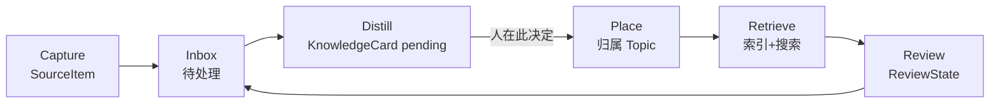
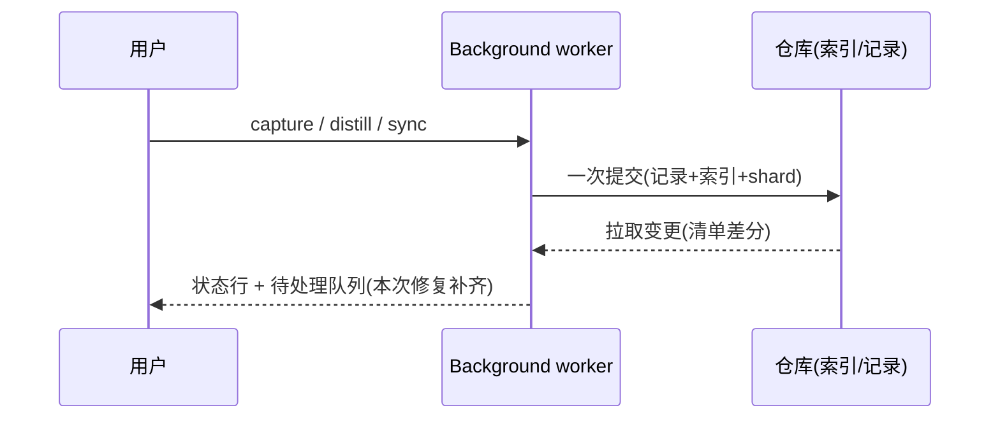

# Blueprint: 设计理念入文档 · 全量功能审计 · 统一优化

## 1. Requirement Summary

把"**对用户知识工作流的理解深度**"与"**AI 与用户协作的优雅程度**"确立为产品的**基本设计理念**，
写成可判定的判据与门禁（R1）；用同一套判据对**当前全部功能实现**做一次证据化审计（R2）；
并按优先级**统一优化**审计发现的问题（R3，代码+测试+文档）。

### 1.1 理念的操作化（Phase 1 冻结，R1 的实质内容）

理念不是标语，落成 6 条**可判定判据**——每条都必须是"能指着某个实现说是/否"的问题：

| # | 判据 | 判定问题 | 反例（现状中已确认存在的） |
|---|------|----------|---------------------------|
| W1 | 捕获零心流成本 | 用户是否需要离开当前页面/上下文、是否需要先做分类决策？ | — |
| W2 | 归宿可见 | 每条进入系统的内容，是否有一处**必须由人处理**的队列，且能看到它下一步去哪？ | `cards/pending/` 写入后无任何出口 |
| W3 | 决策权在人 | AI 产出是否结构性只提案？提案是否有一处等人按下接受/改写/丢弃？ | 提案只能去 GitHub 手改 |
| W4 | 可逆与可理解 | 任何自动动作能否低成本撤回/理解？冲突是否有决策面而非噪音文件？ | `.conflict-<stamp>.md` 成为仓库噪音 |
| W5 | 检索即回报 | 模糊回忆（不记得原词）能否命中？ | 仅关键词 + bigram |
| W6 | 静默失败是可耻的 | 后台自动化失败时，用户能否在 3 秒内知道哪里坏了、该做什么？ | 错误码被隐藏，只显示"失败" |

**门禁形式**：`docs/product/00-design-principles.md`（判据 + 反例 + 每个 Feature 必答清单 + CR 条目）
+ 新增 `AGENTS.md`（非协商规则，指向该文档）+ `04-design.md` 每个 Feature 增"工作流与协作"必答节。

## 2. Architecture Overview

本需求**不新建运行时模块**：三件交付物分别落在文档层、审计层与既有模块的修复上。

- **文档层**（R1）：`docs/product/00-design-principles.md`（新增）· `AGENTS.md`（新增）· `README.md`（一句话立场）·
  OmniDev 状态文档（`00-project-context.md` § Architecture Patterns、`04-design.md` 模板、`08-spec.md`）。
- **审计层**（R2）：`docs/audits/00-functional-audit.md`（新增）——按工作流 6 阶段 × CKF 4 类记录 × 6 判据矩阵，
  逐条给 `文件:行` 证据，并单列：死代码 / 从未被创建的记录类型 / 无出口状态 / 静默失败路径。
- **修复层**（R3）：扩展（`apps/extension/lib/**`、`entrypoints/**`、`apps/git-bridge/src/**` 视需要）——
  按 Phase 2 冻结的优先级清单执行，每一项都必须同时交付 UNIT/INT/E2E 证据。

上图是理念要求产品必须打通的闭环：现状只有 `Capture → Inbox → Distill`，`Place / Review` 只有存储格式、
没有体验（`Topic` / `ReviewState` 从未被生产路径创建）。审计会逐段确认这条链上每一环的"进入/处理/离开"是否存在。

## 3. Module / Service Breakdown

| 交付物 | 责任 | 关键接口/落点 | 依赖 |
|--------|------|---------------|------|
| `docs/product/00-design-principles.md` | 理念、6 判据、反例、Feature 必答清单、CR 门禁 | 纯文档 | — |
| `AGENTS.md` | 面向 agent 的非协商规则（安全 P0、判据门禁、证据要求） | 纯文档 | 判据文档 |
| `docs/audits/00-functional-audit.md` | 全量功能的证据化审计结论与修复清单 | 纯文档（引用 `file:line`） | 现有代码 |
| 提案闭环（P0-1） | 待确认卡片可见 + 接受/改写/丢弃 | 新 request type（契约 Phase 2 冻结）+ popup/options 界面 + 卡片状态流转 | 现有 `cards/pending/`、`listPendingCards`、codec |
| 冲突决策面（P0-2） | 可比较摘要 + 保留我的/保留远端/都留 + 败者归档 | `sync.status` 扩展 + UI + 归档路径 `archive/conflicts/**` | `reconcile.ts`、`engine.ts` |
| 失败可读化（P1-1） | ErrorCode → 双语可执行指引 + 一键重试 | `lib/status.ts`、`lib/i18n.ts`、状态行 | 现有错误码体系 |
| SSH 克隆引导（P1-2） | 预填 `git clone <你的远端>` + 复制 + 路径校验 | options 存储页 | `lib/ui/auth-form.ts` |
| 本地检索增强（P1-3，可降级） | 词项扩展/本地向量，默认关、零出网 | `lib/search/**` | 现有索引 |
| AI 本地主动性（P2-1，仅本地规则） | 去重提示 / 归属建议 / 复习队列 | 捕获路径 + UI | CKF 记录、缓存 |
| 首启层级选择（P2-2） | 首次配置显式选择加密取舍（各配一句人话） | options 首启流程 | `tier.ts` |

## 4. Data Flow

R1/R2 是"人读+人判"的文档流，R3 的修复延续既有数据流：

审计要回答的是：这条链上每一步是否都有"人能看到、能决定、能撤回"的出口；缺失处即为修复项。

## 5. Integration Points

- **Existing modules affected**: `lib/sync/{engine,reconcile}.ts`（冲突决策面）、`lib/background/handlers.ts` + `lib/messages.ts`
  （提案闭环的新 request type、sync.status 扩展）、`lib/store/{github-store,codec,tier}.ts`（卡片状态与归档路径）、
  `lib/status.ts` + `lib/i18n.ts`（失败可读化）、`entrypoints/{options,popup}/**`（三处界面）、`lib/search/**`（检索增强）。
- **External dependencies**: 无新增。不引入任何新依赖是硬约束（保持 bundle 与供应链不变）。
- **Frontend impact**: **yes** — 三处新界面/界面扩展（待处理卡片、冲突决策、失败指引），首启层级选择。

## 6. Design Assumptions (Phase 1, autopilot 自动确认)

| # | Assumption | Risk | Validation |
|---|-----------|------|------------|
| A1 | 6 条判据足以判定"所有功能实现"（不需要第 7 条才有结论） | 🟡 | 审计先跑 3 个代表功能（capture / sync / search）试点，若出现判据无法裁决的条目就补判据并更新文档 |
| A2 | 所有修复都不降低既有安全属性（密钥仅后台、AI 出网三重闸门、vault 不明文降级） | 🔴 blocking | 每个修复跑 B.22 + `assert:content` + 全量 E2E；新增 request type 必须进 `SECRET_BEARING_TYPES` 与限流预算 |
| A3 | 提案闭环需要扩展 request type（对外契约变更），用户接受"先冻结契约再实现" | 🟡 | Phase 2 冻结契约；契约冻结后 Phase 3 不得再改 |
| A4 | 冲突"三选一"可以在不改动"永不销毁"原则下提供（败者归档而非删除） | 🟡 | Phase 2 设计归档路径与回滚；E2E 断言两个版本都还能被找回 |
| A5 | 检索增强（P1-3）若做必须零出网、默认关；不做也不阻塞本次交付 | 🟢 | Phase 2 定去留；若做，E2E 断言默认关闭时行为与今天一致 |
| A6 | 现有 543 UNIT + 111 INT + 8 SYS + 12 E2E 是回归基线，修复不得使其变红（只允许有理由地更新断言） | 🟢 | 每次修复后跑全量；断言变更必须在 `03-progress.md` 记录理由 |
| A7 | 文档型交付不进入扩展包，不影响 bundle 体积与内容包断言 | 🟢 | `npm run build` + `assert:content` 不变即可 |

## 7. Open Questions (Phase 1, autopilot 按默认值接受)

| # | Question | Impact | Default（已采用） |
|---|----------|--------|-------------------|
| Q1 | 审计的"所有功能"边界在哪？ | 审计工作量与结论可信度 | 以 `REQUEST_TYPES`(26) + CKF 4 类记录 + 工作流 6 阶段为枚举基线；未实现的外部适配器（GitLab/Gitee/本地 FS/小程序）只记录"未实现"不深审 |
| Q2 | P2 项（AI 主动性 / 首启层级选择）本次做还是延后？ | 本次容量 | 只做**本地规则**部分（去重提示、归属建议、复习队列的**计算与呈现**）；生成式 AI、语义检索延后到下一个需求并写入 open backlog |
| Q3 | 冲突败者如何处置？ | 数据安全与仓库整洁 | 归档到 `archive/conflicts/<原路径>`，不删除（延续"笔记是归档不是销毁"） |
| Q4 | 理念文档落点与门禁形式？ | R1 的交付形态 | `docs/product/00-design-principles.md` + 新增 `AGENTS.md` + README 一句话；`04-design.md` 每个 Feature 增"工作流与协作"必答节 |
| Q5 | 是否新增 request type？ | 契约与安全面 | 是：`cards.list` / `card.decide`（accept|edit|discard）；加入 `SECRET_BEARING_TYPES` + 限流预算；Phase 2 冻结 |
| Q6 | 失败可读化是否暴露 worker 原始错误文本？ | 密钥卫生 | 不暴露原文；只把 `ErrorCode` 映射为双语可执行指引 + 建议动作（保持现有 `status.ts` 的卫生决策） |

## 8. Risk Log

| Risk | Likelihood | Impact | Mitigation |
|------|-----------|--------|------------|
| 审计发散，Phase 2 无法收敛 | 高 | 高 | 每条结论必须能写出"判据 + 证据 + 可测验收"，不能写出的归入 `open backlog` 并明确延后 |
| 修复面过大导致安全/回归风险 | 中 | 高 | 按 P0→P1→P2 串行；每组结束跑全量测试 + 增量 B.22；A2 为 blocking 假设 |
| 新增 request type 扩大攻击面 | 中 | 中 | 全部进 `SECRET_BEARING_TYPES`（仅扩展页面可发）+ 限流；`card.decide` 只接受受限枚举与长度上限；B.22 专项复核 |
| 卡片状态流转破坏 vault 模式（改写卡片需要解密-加密） | 中 | 中 | 卡片决定走 codec 的 `encodeRecord` 而非裸写；锁定 vault 时拒绝并提示解锁（SC-F5-04 的同类规则） |
| 冲突归档引入新的仓库噪音 | 中 | 低 | 归档集中在 `archive/conflicts/**` 且 `NOTES.md` 不索引；E2E 断言主路径不再产生兄弟文件 |
| 界面新增导致 i18n 字典不平齐 | 中 | 低 | 沿用 `lib/i18n.ts` 双语 + parity 测试；新增键同一次提交 |
| 文档写完即漂移（理念与代码脱节） | 中 | 中 | `AGENTS.md` 指向判据文档；`04-design.md` 必答节 + CR 条目把门禁固化进流程；审计报告带 `file:line` 便于复核 |

## 9. 交付顺序（Phase 2 将细化为任务）

1. R1 文档层（判据 + AGENTS.md + README 立场 + 04-design 模板接节）
2. R2 审计报告（矩阵 + 证据 + 修复清单）
3. R3 P0-1 提案闭环 → P0-2 冲突决策面 → P1-1 失败可读化 → P1-2 SSH 引导 → P2-1 本地主动性 → P2-2 首启选择
4. P1-3（检索增强）按 Phase 2 结论决定是否纳入
