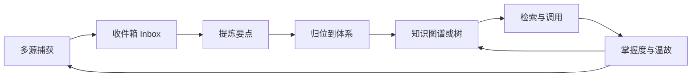
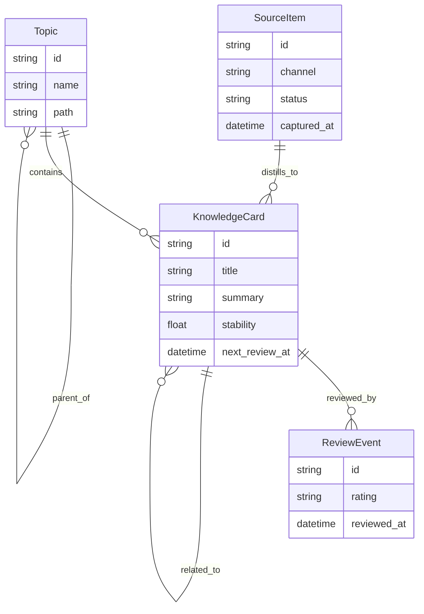
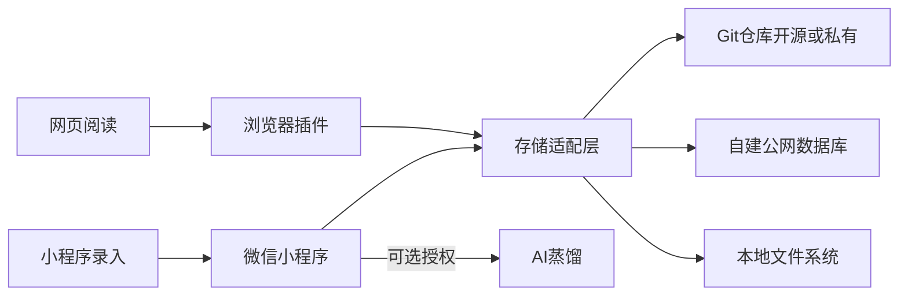

# OmniPilot Synapse — 需求挖掘文档

> 个人智囊袋 / 智能化多领域知识管理与治理平台  
> Repository: [zayeagle/omnipilot-synapse](https://github.com/zayeagle/omnipilot-synapse)

**Description**: Intelligent multi-domain knowledge management and governance — capture from WeChat and browser, systematically organize and govern personal knowledge, AI-distill key points, and spaced-review for retention. Pluggable storage: Git, self-hosted DB, or local files.

---

## 1. 问题本质

用户真正缺的不是「又一个笔记 App」，而是一条能把 **信息 → 知识 → 能力** 走通的管道：

| 现状 | 断裂点 | 期望状态 |
|------|--------|----------|
| 多渠道获取 | 入口碎、手工搬运成本高 | 一处自动汇聚 |
| 收藏/摘录很多 | 只是「存着」，未内化 | 进入可生长的个人体系 |
| 学过又忘 | 无衰减感知、无主动唤起 | 系统代为温故 |
| 材料杂乱 | 缺要点、缺结构 | 自动提炼可复用的知识要点 |

产品一句话定位：

> **个人知识操作系统**：自动收纳多源材料，结构化为可检索的知识节点，并按遗忘曲线主动催复习、催补全。

已锁定产品立场：

- **个人私用**：单用户、无团队协作、无社交分享（导出仅用户主动发起）
- **高安全优先于便利**：安全与隐私是 P0，可为此牺牲部分「全自动云端聪明」
- **首发形态**：**微信小程序 + 浏览器插件**（见第 5A 节分工）
- **存储可插拔（用户自选权威源）**：支持 Git 仓库（开源/闭源托管）、自建公网可访问数据库、本地文件系统（见第 5B 节）；应用不绑架数据到单一厂商库
- **安全按后端分级**：默认仍坚持「正文尽量对第三方不可读」；密钥由用户掌握；AI 明文外发需显式授权
- **AI 可选且可控**：任何明文外发推理必须显式授权、可审计、可按条关闭
- **人在回路**：AI 只提案，不默默改写用户原意

---

## 2. 核心用户故事（对应四痛点）

### P1 多源汇聚

- 作为学习者，我希望微信/网页/PDF/对话/语音随手丢进智囊袋，系统自动落库并初步打标签，而不必打开文档手工粘贴。
- 验收：从「看到」到「入库」≤ 2 步；支持稍后处理队列。

### P2 纳入体系（而非堆收藏）

- 作为沉淀者，我希望每条材料被建议挂到知识树/主题簇，并生成「这条材料贡献了什么知识点」，否则它只是书签。
- 验收：入库后 24h 内有「待归位」清单；确认归位后可在体系视图中看到。

### P3 主动温故

- 作为记忆会衰退的人，我希望系统根据上次复习时间、掌握自评、调用频率，推送今日温故；模糊的知识优先出现。
- 验收：有「今日复习」入口；长期未触达的节点会升权提醒，而不是静静躺尸。

### P4 要点提炼

- 作为需要调用知识的人，我希望对一篇长文/一次经历，系统给出结构化要点（结论、适用场景、反例、相关节点），即使我当初没写总结。
- 验收：任意节点可一键「提炼要点」；要点可回写为子节点或卡片。

---

## 3. 核心闭环（产品心跳）

设计原则：

1. **Inbox 是第一公民**：允许先扔后理，降低捕获摩擦。
2. **要点卡片是第二公民**：比原文更重要；原文是证据，要点是资产。
3. **复习是第三公民**：没有复习队列，体系会退化成坟场。
4. **体系是慢变量**：树/图可演化，但不强迫用户先建完美 taxonomy。

---

## 4. 能力分层（需求地图）

### 4.1 捕获层（解决痛点 1）

**必须支持的模态（MVP → 增强）**

- MVP：文本粘贴、网页剪藏（链接 + 正文抽取）、本地文件（md/pdf/txt）、手动笔记
- 增强：浏览器扩展一键剪藏、截图 OCR、语音转写、聊天记录导入、邮件/RSS、API/快捷指令（iOS/Android）、微信生态（若合规可达）

**捕获对象模型**

- `SourceItem`（原材料）：url/file/transcript/raw_text、渠道、时间、原始附件
- 状态：`inbox` → `processing` → `ready` → `placed` / `archived` / `trash`

**关键需求**

- 去重与合并（同 URL、近重复正文）
- 离线可捕获，联网后补全抽取
- 「稍后处理」不阻塞捕获

### 4.2 蒸馏层（解决痛点 4）

对每条 `SourceItem` 产出结构化产物（可编辑）：

- 标题 / 一句话摘要
- 要点列表（3–7 条为佳）
- 适用场景 / 前提条件
- 反例或边界（可选）
- 推荐标签与父主题
- 开放问题（用户未搞懂的点）

产物落为 `KnowledgeCard`（知识卡片），并保留指向原文的证据链接。

**人机协作规则**

- AI 提案默认「待确认」
- 用户可：采纳 / 改写 / 拆成多卡 / 合并 / 驳回
- 驳回要留下反馈，用于后续分类偏好

### 4.3 体系层（解决痛点 2）

知识不是文件夹堆叠，而是「可挂接的网络」：

- `Topic`（主题节点）：可树状浏览（导航友好）+ 图状关联（真实关系）
- `KnowledgeCard` 挂到 1 个主 Topic + N 个相关 Topic
- 关系类型（MVP 简化）：`belongs_to` / `related_to` / `supports` / `contradicts` / `derived_from`

**「纳入体系」的可操作定义**（产品必须可度量）

一条材料算「已纳入」当且仅当：

1. 有确认后的要点卡，且
2. 挂到至少一个 Topic，且
3. 有初始掌握度，且
4. 进入复习调度

未满足则停在 Inbox/待归位，系统持续提醒处理积压。

### 4.4 检索与调用层（四痛点的出口）

场景：

- 语义检索：「上次那个关于跨部门沟通的复盘结论是什么？」
- 体系浏览：从 Topic 下钻到卡片与证据
- 情境召回：写文档/开会前，按主题拉「我掌握的要点」
- 对比召回：互相矛盾的笔记并排提示（增强）

输出形态优先「要点卡 + 证据片段」，避免只丢长文。

### 4.5 温故与掌握度层（解决痛点 3）

**掌握度模型（MVP 务实版）**

每个 `KnowledgeCard` 维护：

- `stability`：记忆稳定度（受复习表现影响）
- `retrievability`：当前可提取概率（随时间衰减）
- `last_reviewed_at` / `next_review_at`
- `self_rating`：又会 / 模糊 / 不会（用户反馈）
- `use_count`：被检索/引用次数（主动调用也算复习）

调度策略（不必首版上完整 FSRS，但要对齐思路）：

- 新卡：短间隔确认
- 模糊/失败：缩短间隔并升权进「今日温故」
- 长期未触达且曾标记「会」：触发「防遗忘抽检」
- 被频繁成功调用：拉长间隔

复习交互（低负担）：

- 先出示线索（标题/场景问），再揭要点
- 三种按钮：记住了 / 有点忘 / 忘了
- 可选：生成小测验 / 让用户用一句话复述（增强）

**主动提醒**

- 应用内「今日温故」
- 系统通知（可控频率，防骚扰）
- 周报：本周衰减风险 Top N、Inbox 积压、体系新增

---

## 5. 关键对象与信息架构

主导航建议（少而硬，主要落在小程序）：

1. **收件箱**（捕获与待归位）
2. **体系**（主题树/图谱）
3. **今日温故**
4. **检索**
5. **洞察**（周报、掌握度热力图、薄弱主题）

---

## 5A. 产品形态与端侧分工（已锁定）

首发只做两端，分工清晰，避免两边都做全功能导致安全面膨胀。

### 浏览器插件（捕获先锋）

- 一键剪藏：标题、URL、正文抽取、划线摘录、网页快照（可选）
- 经存储适配层写入用户选定的权威存储（写入前按策略加密）
- **不承载**完整知识库浏览/复习（降低扩展权限与被攻击面）
- 可直连：自建库 API、Git 远程；本地文件系统需本机伴随能力（见 5B）

### 微信小程序（日常主场）

- Inbox 处理、要点确认、归位到体系
- 今日温故、检索、主题浏览、周报
- 轻量捕获：粘贴文本、拍照/图片 OCR（若合规）、语音输入
- 订阅消息：只推「有 N 条待复习」，不推知识点正文
- **不能直接读本地磁盘**；选「本地文件系统」时，须通过用户自建同步桥或改选 Git/自建库

### 明确后置

- 独立桌面 App、原生 App：增强阶段再做（会显著改善「本地文件系统」体验）
- 微信内「分享卡片到好友/朋友圈」：默认不做

### 形态带来的架构结论

- 客户端与存储解耦：**Canonical Knowledge Format + Storage Adapter**
- 小程序要跨端可用，权威存储须是「小程序能经 HTTPS 触达」的后端（Git 托管 API / 自建库），或经用户自建桥接
- 「本地文件系统」是一等公民存储形态，但在小程序首发里属于 **受限可达**（见 5B 可用性矩阵）

---

## 5B. 数据存储：可插拔多形态（已锁定）

产品不自建「唯一真相库绑架用户」，而是提供统一知识模型，背后可挂三种权威存储。

### 统一知识落地格式（与后端无关）

- 原文 / 附件：文件或 blob（Markdown/HTML/PDF/图片等）
- 知识卡片、主题树、关系、复习状态：结构化记录（JSON/SQLite 行/Markdown frontmatter，按适配器映射）
- 所有适配器必须支持：导入、导出、备份、销毁；保证用户可迁出

### 形态 A：开源或闭源 Git 仓库

- 含义：用户自有 Git 远程（GitHub / GitLab / Gitee / 自建 Gitea 等），可为 public 或 private
- 落地建议：仓库即知识库（如 `sources/`、`cards/`、`topics/`、`review/`），以 Markdown + YAML/JSON 为主，便于人工审阅与版本历史
- 能力：版本可追溯、可 diff、可自备备份；闭源私有仓满足「不想公开」
- 安全：private 仓 + 最小 scope token；可选客户端先加密再提交（密文仓，牺牲明文 diff）
- 端侧：插件/小程序经 Git Provider API 或用户自建 git-bridge 读写；凭据只存端侧保险库

### 形态 B：自己部署、公网可访问的数据库

- 含义：用户自备公网可达的数据面（Postgres/MySQL/SQLite 服务化均可），或部署官方提供的 **轻量自托管服务端**（推荐，降低用户自己拼库表的成本）
- 落地：API + DB；小程序/插件只认 HTTPS API，不直打裸数据库端口（避免把 DB 暴露给浏览器）
- 安全默认：库内静态加密或应用层字段加密；TLS 必开；访问密钥/设备绑定；可选 E2EE（服务端只存密文）
- 这是小程序体验最完整的路径（温故调度元数据、Inbox、多端一致最顺）

### 形态 C：本地文件系统

- 含义：用户指定本机目录为权威库（类 Obsidian Vault：文件夹 + Markdown）
- 端侧现实约束：
  - **浏览器插件**：可借助本机伴随程序（Native Host）或「仅在本机浏览器配置下」访问用户授权目录（能力因浏览器而异）
  - **微信小程序**：**无法直接挂载电脑/手机任意目录**；若用户坚持本地权威，需「本机同步桥 → 临时可达面（自建库/Git）」或等桌面端
- 安全：目录权限 + 可选目录级加密容器；不把明文自动上传任何第三方
- MVP 策略：插件侧先支持「导出/同步到本地目录」；完整「本地权威 + 小程序实时读」放到桌面桥接阶段，但需求上认定本地 FS 为一等形态

### 可用性矩阵（需求约束，不是实现细节）

| 存储形态 | 浏览器插件 | 微信小程序 | 安全默认建议 |
|----------|------------|------------|--------------|
| Git 仓库 | 可达 | 可达（经 API/桥） | 私有仓；可选密文提交 |
| 自建公网 DB/自托管服务 | 可达 | 可达（最佳） | TLS + 字段/E2EE 加密 |
| 本地文件系统 | 条件可达 | 需桥接/后置 | 本机权限 + 可选加密容器 |

### 存储选择与切换（产品需求）

- 首次引导：三选一配置向导（可后续迁移）
- **同时只允许一个权威写源**，避免双写冲突；允许「导出到另一种形态」作为备份
- 迁移：Git ↔ 自建库 ↔ 本地目录 之间可一键迁出/迁入（格式稳定）
- 冲突：以「最后写入 + 冲突副本保留」为 MVP；Git 形态可暴露合并状态

### 与「官方云」的关系

- 官方可提供可选托管，但 **不得** 作为唯一选项
- 未配置官方托管时，用户数据只存在其选定的 A/B/C 中

---

## 6. 安全与隐私需求（P0，个人私用硬约束）

安全目标一句话：

> **无论数据落在 Git、自建库还是本地目录，未授权方（含托管方运维）都应尽可能无法直接阅读知识正文；AI 明文处理必须用户知情同意。**

### 6.1 威胁模型（至少覆盖）

- 微信环境：小程序被他人打开、微信账号被盗
- 自建库被入侵 / Git 托管方可读 / 本地目录被其他进程读取
- 浏览器插件被恶意网页利用：注入伪造内容或盗用投递 token
- 模型调用外泄；传输窃听；供应链篡改
- 用户误把知识库 Git 设为 public

### 6.2 安全基线（MVP 必须具备）

1. **按存储后端的加密策略**
   - **自建库**：默认应用层加密或 E2EE；TLS 必开；推荐官方自托管镜像而非裸露 DB 端口
   - **Git**：默认要求 private；支持「明文可读仓（便于 diff）」与「密文仓（更高安全）」两种档位，由用户选
   - **本地 FS**：目录 ACL + 可选加密容器；禁止默认把本地库镜像到第三方明文云
   - 用户主密钥/仓库 token/DB 密钥只存端侧保险区；提供恢复码；丢钥风险明示

2. **元数据最小化（对非本地后端）**
   - 调度可用：卡片 ID、`next_review_at` 等不含正文字段
   - 首版检索偏端侧解密后搜索；避免在不可信后端建明文向量库

3. **传输与凭据**
   - 全站 TLS；插件/小程序短期 token + 可撤销
   - Git PAT / DB API Key 可轮换；最小 scope

4. **端侧锁与微信侧防护**
   - 小程序二次锁；会话超时；订阅消息禁止知识点明文

5. **AI 外发最小权限**（默认关、授权分级、脱敏、账本）

6. **无账号社交面**；导出加密包；不做默认微信分享

7. **插件通道隔离**：只写 Inbox；token 可撤销；防投毒

8. **删除与可迁移**：各后端均可彻底删除 + 统一导出；存储可切换，避免厂商锁定

9. **审计与透明**：展示当前权威存储类型、AI 外发状态、已授权设备；日志禁止打印正文

### 6.3 安全模式分级（产品可配置）

- **金库模式（默认）**：对非本地后端启用内容加密；AI 关闭
- **透明仓模式（仅 Git 可选）**：明文 Markdown 便于版本阅读；用户确认风险后开启
- **增强智能模式**：授权后明文送 AI 蒸馏（带账本）

原则：默认金库；任何「明文落第三方」必须显式确认。

### 6.4 与四痛点的张力及取舍

| 能力 | 做法 |
|------|------|
| 多源汇聚 | 插件+小程序写入同一适配层，落到用户选定权威存储 |
| AI 归类/摘要 | 默认关；授权后短时明文，结果写回存储 |
| 语义检索 | 端侧优先；自建库可后置密文/可控索引 |
| 温故提醒 | 只推数量；调度元数据可与正文分离存放 |
| 本地 FS + 小程序 | 需求保留；首发靠桥接或引导改用 Git/自建库 |

接受的代价：本地 FS 在小程序侧不能「开箱即完美」；Git 密文仓失去漂亮 diff；自建库需要用户有可公网访问的部署。

---

## 7. 其他非功能需求

- **信任**：原文可追溯；AI 改动可审计；误分类可逆
- **低摩擦**：插件剪藏 ≤ 2 步；小程序复习单次 ≤ 30–60 秒/卡；安全解锁做成会话级
- **抗积压**：Inbox 清零有节奏设计（每日处理上限建议 + 智能合并）
- **可迁移**：导入导出 Markdown/JSON/加密容器
- **性能**：小程序包体与首屏可控；插件剪藏秒级反馈；加解密不可显著卡顿

---

## 8. 与现有工具的差异

| 能力 | 书签/收藏 | Notion/文档 | Anki | 云笔记+AI | 本产品 |
|------|-----------|-------------|------|-----------|--------|
| 多源自动汇聚 | 弱 | 手工 | 弱 | 中 | 强（插件+小程序） |
| 体系化归位 | 无 | 靠用户 | 牌组粗粒度 | 弱 | AI+用户共构 |
| 要点蒸馏 | 无 | 靠用户 | 靠用户制卡 | 有但常上云 | 默认产出且可控外发 |
| 防遗忘调度 | 无 | 无 | 强但制卡重 | 弱 | 对已有材料自动进调度 |
| 掌握度可视 | 无 | 无 | 有 | 弱 | 主题级+卡片级 |
| 个人数据主权 | 中 | 低-中 | 高 | 低 | **高（可插拔自有存储）** |
| 触达形态 | 浏览器 | App/Web | App | App/Web | **微信小程序+插件** |

差异化一句话：**在微信与浏览器里完成「捕获 → 纳入体系 → 主动温故」，数据落在你自己的 Git / 自建库 / 本地目录，而不是被单一云笔记绑架。**

---

## 9. MVP 边界

**做**

1. **浏览器插件**：网页剪藏/划线 → 经适配层写入 Inbox
2. **微信小程序**：Inbox、蒸馏确认、体系、检索、今日温故、周报、轻量录入
3. **存储适配层 MVP**
   - 优先打通：**自建公网可访问服务（官方自托管包 + 用户 DB）**
   - 同期或紧随：**Git 私有仓**（Markdown 知识库）
   - **本地文件系统**：插件侧导入/导出/同步到目录；小程序完整直连后置（桌面桥）
4. AI 蒸馏：默认关云，授权后可用
5. 体系 / 端侧检索 / 温故三档 + 订阅消息（仅数量）
6. **安全基线**：按后端加密策略、小程序锁、插件最小权限、AI 账本、统一迁出/销毁

**明确不做（首版）**

- 独立桌面客户端（但需求预留本地 FS 完整方案）
- 团队协作/社交分享
- 强制官方托管云、明文默认上传
- 默认开启第三方云模型
- 多权威源同时双写
- 过度复杂图谱编辑器、考试级题库

---

## 10. 成功指标

- **捕获成功率**：插件剪藏成功率；小程序周入库条数
- **归位率**：30 天内 `placed` 卡片占比
- **复习遵从**：订阅消息后 24h 完成率
- **抗遗忘 / 调用价值 / 积压健康度**
- **存储自主**：非官方托管占比；成功完成「换存储迁出」的用户比例
- **安全健康度**：金库模式占比；误公开 Git 仓告警次数；丢钥恢复引导完成率

---

## 11. 主要风险与对策

- **AI 乱分类/胡摘要** → 待确认流 + 证据引用 + 一键回滚
- **Inbox 坟场** → 每日处理预算、合并重复
- **复习骚扰** → 配额；通知不含正文
- **多存储复杂度过高** → 统一 Canonical Format；MVP 先自建库+Git，本地 FS 分阶段
- **小程序 × 本地 FS 不可直连** → 向导诚实说明；提供桥接/改选路径，不假装已支持
- **Git 明文仓误公开** → 创建时检测 public、强警告、可选密文仓
- **自建库运维负担** → 提供一键自托管镜像，禁止引导用户把裸 DB 端口暴露公网
- **加密 vs diff/检索** → 档位化（金库/透明仓）；默认金库
- **为方便回退唯一明文官方云** → 红线：官方托管只能是可选项，且同等加密标准

---

## 12. 下一步

需求主线已收敛为：

**四痛点闭环 × 个人私用 × 高安全 × 微信小程序+浏览器插件 × 可插拔存储（Git / 自建库 / 本地 FS）**

下一步：输出 **PRD**（双端功能清单、存储适配器配置流、页面信息架构、安全用例、字段级说明）。
